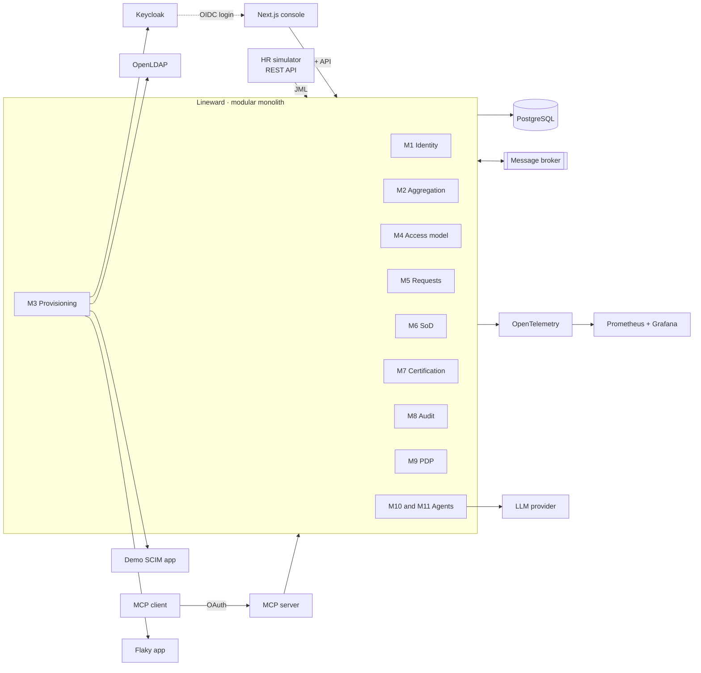

# Lineward

[](https://github.com/devAyyoub/Lineward/actions/workflows/build.yml)
[](LICENSE)

**Open source Identity Governance and Administration (IGA) platform, with governance for AI agents.**

Lineward aggregates accounts from heterogeneous systems, correlates them with identities, provisions access through approval workflows with segregation of duties control, produces audit evidence for recertification campaigns, and extends that same governance to the AI agents acting on people's behalf.

> **Status: work in progress. Phase 1 of 8.**
> Nothing aggregates, correlates or provisions anything yet. What works is the first step of the identity lifecycle: the platform reads the authoritative source over HTTP, page by page or only what changed, stores what that source asserted separately from its own governed view of each person, derives the lifecycle status from the dates asserted, and records who answers for whom. Re-reading an unchanged extract writes nothing. Under that sits the foundation: the schema with per-tenant isolation enforced by PostgreSQL row level security, tested against a real PostgreSQL. What is not built yet is the part that turns a difference between two reads into a joiner, a mover or a leaver, and everything downstream of it. This README tracks real progress, not intentions.

---

## The problem

In any organization above a few hundred people, nobody can answer three questions with confidence:

1. **Who has access to what?** Accounts live in dozens of disconnected systems: a directory, an identity provider, a payroll application, a dozen SaaS products.
2. **Why do they have it?** Access accumulates. People change teams and keep the permissions of their previous role, a pattern known as privilege creep. Somebody granted a permission by hand two years ago and nobody remembers why.
3. **Should they still have it?** Accounts outlive the people who owned them. Orphan accounts, the most common audit finding in access control, belong to nobody and often still work.

IGA is the discipline that answers those questions, and it is what regulators ask about first when they audit access control. Lineward implements it end to end.

And it adds the dimension that matters now: AI agents act with credentials, and they bring back every problem IGA already solved for people, multiplied by their speed and autonomy. Agents with shared API keys that never expire. Agents with more permissions than they need. Agents still running after the project that created them ended. No way to tell **on whose behalf** an agent acted.

**Lineward treats AI agents as first class identities, governed exactly like human ones.**

---

## What it does

| Module | Capability | Phase | Status |
|---|---|---|---|
| M1 | Identities and authoritative source, with joiner, mover and leaver lifecycle events | 1 | In progress: the source is ingested, the lifecycle events are not derived yet |
| M2 | Aggregation, correlation and reconciliation, including orphan account and drift detection | 1 | Planned |
| M3 | Connectors and provisioning: Keycloak, LDAP, SCIM 2.0, plus a deliberately unreliable app to prove resilience | 2 | Planned |
| M4 | Access model: entitlements, business roles, access lineage, basic role mining | 3 | Planned |
| M5 | Access requests and configurable approval workflows | 3 | Planned |
| M6 | Segregation of duties, preventive and detective, with exceptions and a conflict simulator | 3 | Planned |
| M7 | Access certification campaigns, including rubber stamping detection | 4 | Planned |
| M8 | Hash chained audit log with an integrity verifier, and compliance reporting | 4 | Planned |
| M9 | Real time authorization: a policy decision point with ABAC policies as code | 5 | Planned |
| M10 | AI agent identity governance: delegation, permission intersection, kill switch | 6 | Planned |
| M11 | AI agents serving IAM: certification copilot, natural language queries, MCP server | 7 | Planned |

---

## The AI angle

Lineward works on both sides of the same problem.

**IAM for AI: governing agents.** An agent is an identity with a lifecycle, a mandatory human sponsor, its own access, its own certification campaigns and its own audit trail. Its tools are modeled as entitlements, so being allowed to call `request_access` is a permission that gets requested, approved and recertified like any other. When an agent acts for a person, delegation is explicit: the token carries the person as subject and the agent as actor, following RFC 8693 token exchange. **Effective permissions are the intersection of both**, so an agent acting for someone can never do something that person could not do. If the sponsor leaves the organization, the agent is suspended automatically. There is a kill switch, per agent and global.

**AI for IAM: agents that help.** Certification campaigns fail in practice because reviewers approve everything without looking, and they do that because they lack context. A copilot that summarizes usage, age, risk, SoD conflicts and comparison with peers in the same role turns a meaningless click into an informed decision. The agent proposes, the human decides. Queries run through typed read only tools, never free SQL, and always with the permissions of whoever is asking.

Every text coming from outside is treated as untrusted data, never as instructions, and the project ships an adversarial eval suite that runs in CI.

---

## Architecture

A modular monolith. Strict internal module boundaries verified by architecture tests, without the operational cost of microservices.



### Standards

The project implements published specifications rather than inventing its own: OAuth 2.x, OpenID Connect, PKCE, SCIM 2.0 (RFC 7643 and RFC 7644), LDAP, Token Exchange (RFC 8693), DPoP (RFC 9449), Rich Authorization Requests (RFC 9396), CIBA and the MCP authorization specification. Compliance capabilities are mapped against DORA, NIS2, ISO/IEC 27001 and the Spanish ENS.

### Stack

Java, Spring Boot, PostgreSQL, Flyway, Keycloak, OpenLDAP, Next.js, Testcontainers, OpenTelemetry, Docker Compose, GitHub Actions.

Exact versions are pinned in [ADR-006](docs/adr/0006-versiones-del-stack.md), with the reasoning for each one and the triggers that would justify revisiting it.

---

## Getting started

The environment comes up, both services run, and the platform ingests the simulated HR population. You need Docker and a JDK 25.

**A JDK 25 to run it, not only to build it.** A Maven toolchain compiles this project with 25 whatever JDK starts Maven, which is the decision in ADR-006, so `./mvnw verify` passes on a machine whose `java` is older while the jars it just built refuse to start there with `UnsupportedClassVersionError` and a class file version. Point `JAVA_HOME` at a 25 before running anything by hand.

```bash
# PostgreSQL 18 and Keycloak 26, with the two database roles that tenant
# isolation depends on created on first start.
docker compose -f infra/docker-compose.yml up -d

# Build and test everything: the platform, the synthetic data generator and the
# simulated HR system. Includes the tenant isolation suite against a throwaway
# PostgreSQL, so a running Docker daemon is required.
./mvnw verify
```

```bash
# Install the modules locally once, so the simulated HR system can resolve the
# generator it depends on.
./mvnw install -DskipTests

# The platform. Applies the schema migrations and starts on http://localhost:8080
./mvnw -pl backend spring-boot:run

# The simulated HR system, on http://localhost:8090. This is the authoritative
# source the platform reads from, and it is a separate process on purpose: if it
# shared a database with the platform, aggregation would consist of Lineward
# reading its own tables.
./mvnw -pl demo-apps/hr-simulator spring-boot:run
```

The simulated HR system generates a 5.000 employee company from a fixed seed, so
it serves the same population on every start. It also publishes the anomalies
seeded into it, which is what lets a test or a demo assert on a specific finding
rather than hope one turns up:

```bash
curl 'localhost:8090/api/v1/employees?page=0&size=5'   # the extract, paged
curl localhost:8090/api/v1/anomalies                   # what was seeded, and where

# Provoke the three lifecycle events. The termination accepts a date in the
# past, which is the retroactive leaver case.
curl -X PATCH localhost:8090/api/v1/employees/E-0500 \
  -H 'Content-Type: application/json' -d '{"department":"Risk"}'
curl -X POST localhost:8090/api/v1/employees/E-0501/termination \
  -H 'Content-Type: application/json' -d '{"terminationDate":"2026-09-20"}'

# Then read only what changed, which is what an incremental ingest does.
curl 'localhost:8090/api/v1/employees?changedSince=2026-10-15T23:00:00Z'
```

To have the platform read that population into its own tables, start it with the
ingestion flag. It is off by default and there is no endpoint for it on purpose:
the platform has no authentication layer yet, and an unauthenticated endpoint
that writes identity data is a worse thing to add than a flag. The scheduled run
and the API arrive with the tasks that need them.

```bash
LINEWARD_INGEST_ON_STARTUP=true ./mvnw -pl backend spring-boot:run
```

It reports what it did, and the three counts are separate for a reason: a run
where everything is unchanged is the normal case and the one that proves the run
is idempotent, while a run where everything counts as updated means change
detection is broken.

```text
Ingested the whole population from source 'hr': 5000 created, 0 updated,
0 unchanged; managers 4974 linked, 0 unlinked, 0 unresolved, 0 preserved
```

4974 is the headcount minus the chief executive, who reports to nobody, minus
the 25 missing-manager anomalies the generator seeded. Running it again reports
5000 unchanged and writes nothing.

PostgreSQL is published on port 5434 and Keycloak on 8081, because 5432 and 8080 are commonly taken. Both are bound to localhost only. Override any of it with the variables documented in [`infra/.env.example`](infra/.env.example).

Two database roles are not an accident: the application connects as a role that owns nothing, so PostgreSQL row level security applies to it. Connecting as the owner would make every isolation policy silently do nothing. The reasoning is in [ADR-011](docs/adr/0011-multiinquilino-aislamiento.md).

---

## Security

An identity governance platform concentrates the answer to "who has access to what" and holds administrator credentials for every target system, so it is a high value target by construction. The posture is recorded in [ADR-014](docs/adr/0014-postura-de-seguridad-del-desarrollo.md) and reporting is covered by [SECURITY.md](SECURITY.md). Two rules do most of the work:

**A control goes where it cannot be bypassed, not where someone remembers not to bypass it.** Tenant isolation is enforced by the database rather than by remembering to filter queries, and the audit trail is append-only by permissions rather than by convention.

**No control is accepted until it has been seen to fail when it should.** This is not a style preference, it is the lesson of two concrete incidents in this repository. ADR-011 claimed row level security applied to Flyway and was corrected after the claim was tested rather than assumed. And on the day dependency scanning was added it reported **no issues found** after silently discarding all sixteen packages it had located, because our versions come from a BOM and it could not resolve them. Given the resolved tree instead, the same scan found ten vulnerabilities, three of them in the embedded server including an authentication bypass.

That second one generalises past this project: **declaring dependency versions centrally is good practice, and it leaves naive tooling with nothing to read.** A correct engineering decision can silently disable a security tool, with no error and a clean report. So the number to read off a security tool is not its verdict, it is how many things it says it checked.

What runs today: dependency scanning that fails the build on every dependency the build actually resolves, continuous monitoring of the resolved tree, secret scanning with push protection, tenant isolation tested against a real PostgreSQL including deliberate negative tests, and module boundaries verified in code by architecture tests. Across the database those same boundaries are reviewed discipline rather than an enforced rule, which [ADR-001](docs/adr/0001-monolito-modular.md) states and which the referential integrity test of phase 1 is meant to close. What else is deliberately absent is listed in ADR-014, because a control described as present and only half built is worse than one that is missing.

---

## Documentation

- [`docs/adr/`](docs/adr/): architecture decision records, one file per decision. This is the public technical record of the project: every significant choice, the alternatives weighed and the consequences accepted.
- [`docs/brand/`](docs/brand/): the visual identity and its usage guide.

The day to day working document, which holds the collaboration rules, the product strategy and the session log, is kept private. ADRs written before that split may reference its sections; the reasoning each one needed is restated inside the ADR itself.

Working documentation is written in Spanish, which is deliberate and recorded in [ADR-002](docs/adr/0002-idiomas.md). Code, APIs and public facing material are in English.

---

## Roadmap

| Phase | Scope | Status |
|---|---|---|
| 0 | Foundations: repository, ADRs, domain model, skeleton, CI | Done |
| 1 | Identities and aggregation | In progress |
| 2 | Connectors and provisioning | Planned |
| 3 | Access model, requests and segregation of duties | Planned |
| 4 | Certification and audit | Planned |
| 5 | Real time authorization | Planned |
| 6 | AI agent governance | Planned |
| 7 | AI agents serving IAM, and the MCP server | Planned |
| 8 | Hardening, performance and public demo | Planned |

---

## About this project

Lineward is an independent project built by Ayyoub Amjahed Abed. It is **not affiliated with, endorsed by or derived from any employer or client**, and it is designed entirely from public standards, open product documentation and industry literature.

All data in the project is **synthetic**, generated reproducibly from a fixed seed. No real personal data is used anywhere, and none should be.

## License

Licensed under the [Apache License 2.0](LICENSE). See [ADR-008](docs/adr/0008-licencia.md) for why.

## Author

Ayyoub Amjahed Abed, [ayyoub.dev](https://ayyoub.dev)
